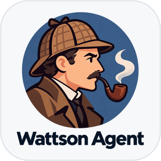
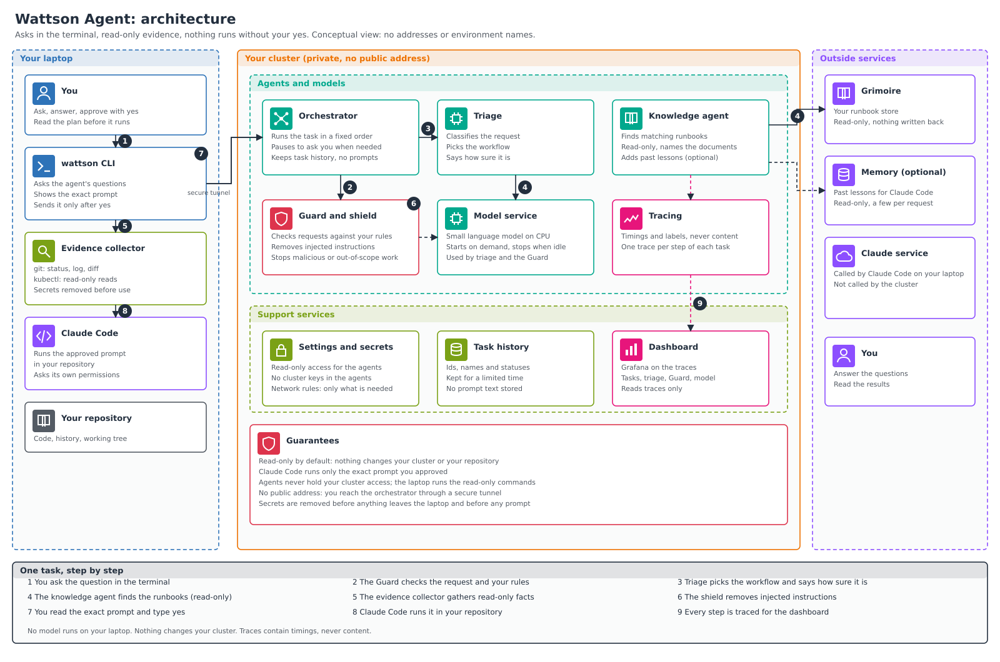
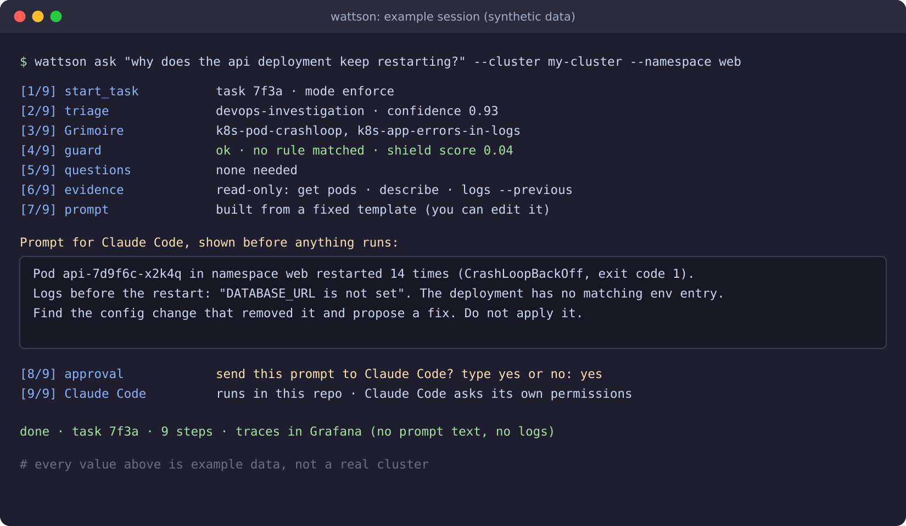
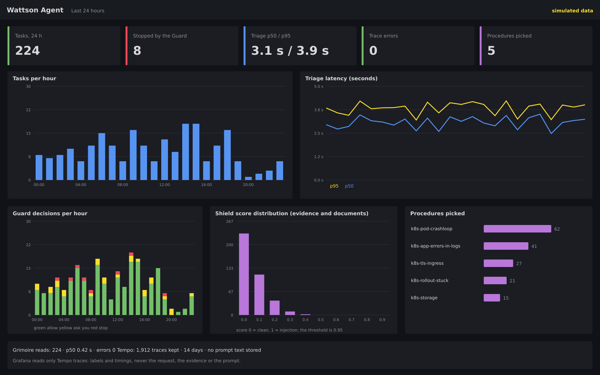

<p align="center"></p>

# Wattson Agent



Wattson Agent is a proof of concept (POC) of a **personal engineering agent**. You ask a question
in the terminal. The agent finds the matching runbook, collects only the facts it needs from your
git repository and your Kubernetes cluster (read-only), and writes a task for **Claude Code**.
You read the whole task, and it runs only after you type `yes`.

It is built with **[Strands Agents](https://strandsagents.com)** and the **A2A** (Agent-to-Agent)
protocol. Three small agents run on Kubernetes and talk to each other over A2A. A command-line
client on your laptop talks A2A to the first agent.



*Example session. All values are synthetic.*

```bash
wattson ask "why does the api deployment keep restarting?" --cluster <your-kube-context> --namespace web
wattson ask "which deployments are not ready?" --cluster <your-kube-context> -A   # all namespaces
```

## Contents

- [How one request flows](#how-one-request-flows)
- [The components](#the-components)
- [The model: KubeAI and the llama.cpp engine](#the-model-kubeai-and-the-llamacpp-engine)
- [Safety: the Guard, the shield, and Cedar](#safety-the-guard-the-shield-and-cedar)
- [Why this infrastructure](#why-this-infrastructure)
- [Measured results](#measured-results)
- [Quickstart](#quickstart)
- [Kubernetes deployment](#kubernetes-deployment)
- [Proof-of-concept limitations](#proof-of-concept-limitations)
- [License and citation](#license-and-citation)

## How one request flows

1. **You ask.** `wattson ask "…"` runs inside a git repository.
2. **The CLI** sends the request to the orchestrator over A2A.
3. **The Guard** checks the request first: is it in scope, safe, and not an attack?
4. **Triage** classifies it: prompt help, DevOps investigation, or engineering task, and says how
   sure it is.
5. **Knowledge** finds the matching runbooks in Grimoire, read-only, and names the documents it used.
6. **Evidence** is collected on your laptop. The CLI runs only the read-only commands the agent
   asked for (`git status`, `git log`, `kubectl get`, `kubectl describe`, `kubectl logs`).
7. **The shield** scores the evidence and the documents for hidden instructions, and removes text
   that tries to give the agent orders.
8. **You approve.** The CLI shows the exact prompt, which you can edit. Nothing is sent before `yes`.
9. **Claude Code** runs the approved prompt in your repository. It still asks its own permission
   questions.
10. **Traces** of each step go to Grafana. They contain labels and numbers, never the prompt, the
    documents, or the logs.

## The components

| Component | Where it runs | What it does in the POC |
|---|---|---|
| **wattson CLI** | your laptop | The only user interface. It asks you the agent's questions, runs the read-only commands it is allowed to run, shows you the prompt, and starts Claude Code after your `yes`. It holds no model and runs no background service. |
| **Connector** | your laptop | Runs only what the agent asks for, read-only: `git`, `kubectl` with a read-only kubeconfig, and the Claude Code command. It removes secrets from the output before anything leaves the laptop. |
| **orchestrator** | Kubernetes | A Strands agent and an A2A server that runs the task. Its steps (start, Guard, triage, Grimoire, questions, evidence, prompt, approval, Claude Code, finish) run in a fixed order written in code. No model decides that order. It pauses with A2A `input-required` when it needs you. |
| **triage** | Kubernetes | A Strands agent that picks the workflow and the procedure. It asks the model (KubeAI, see below) and falls back to keyword rules when the model is unsure. |
| **knowledge** | Kubernetes | A Strands agent and MCP client of **Grimoire** (your runbook store). It uses read-only tools only and keeps its OAuth token in its own volume. |
| **Grimoire** | outside the cluster | Your knowledge base of runbooks, reached over HTTPS and MCP. The POC does not write back to it. |
| **Guard** | in the orchestrator | Checks every request, and the evidence and documents before they go into a prompt. Your rules decide first; a small model can only make the verdict stricter. See [Safety](#safety-the-guard-the-shield-and-cedar). |
| **shield** | Kubernetes, own pod | A small ONNX model that scores text for prompt injection. In `cut` mode it removes the risky parts. Its model is pinned to a fixed version. |
| **KubeAI** | Kubernetes, own namespace | An operator that serves the model behind one OpenAI-style address and starts the model pod on demand. See [The model](#the-model-kubeai-and-the-llamacpp-engine). |
| **Granite model** | KubeAI's pod | IBM Granite-4 (a small model, 4-bit GGUF) with the llama.cpp engine, on CPU. It answers triage and gives the Guard a second opinion. |
| **Cognee memory** | optional | A memory for Claude Code, served over MCP. The knowledge agent reads it read-only and adds up to 3 past lessons per request. |
| **Tempo** | Kubernetes | Stores the traces (OpenTelemetry, OTLP) of all agents. Keeps them for a limited time. |
| **Grafana** | Kubernetes | Shows one dashboard built from the traces: tasks, triage, Guard, shield, Grimoire. It only reads traces. No request, evidence, or prompt reaches it. |
| **Claude Code** | your laptop | Runs the approved prompt in your repository. It is the only component that changes files. |

Kubernetes has no public address for the agents. You reach the orchestrator with a port-forward
and a token from the CLI.

### The dashboard



*Simulated dashboard: the panels show what Grafana displays from the traces (tasks, triage latency,
Guard decisions, shield scores, procedures, Grimoire calls). All numbers are synthetic, generated
with a fixed random seed.*

## The model: KubeAI and the llama.cpp engine

The triage model can run in two places. A setting picks one:

- **`kubeai`** (the default in the POC): [KubeAI](https://github.com/kubeai-project/kubeai) runs
  the model in its own pod behind one OpenAI-style address. It uses the llama.cpp engine.
- **`sidecar`**: a llama.cpp container inside the triage pod. It is simpler, but the model
  always uses its CPU reservation.

You use the CLI the same way with either setting.

**What KubeAI gives you**

- **No CPU used when idle.** The model pod scales to zero when nobody asks, and stays up for a
  set time after the last request, so a working session stays fast.
- **One model service for many apps.** Other applications in the same cluster can use the same
  address, with no API key and no cost per request. Network policies decide which pods may
  reach it.
- **Models as Kubernetes objects.** You add or swap a model with a small YAML file and
  `kubectl apply`. You do not rebuild Wattson.
- **A light triage pod.** The model runs in its own pod, so the agents stay small. The model
  runs on CPU today.

**What it costs**

- **A cluster-wide install:** a CRD for models and a cluster role, plus the operator in its own
  namespace. On a shared cluster, this affects everyone.
- **A slower first request after idle:** the pod starts and downloads the model file, which
  takes about half a minute on the test machine. Triage and the orchestrator have timeouts long
  enough to wait for it. A setting can keep one replica always running, which removes the wait
  and uses the CPU all the time.
- **Versions must be pinned.** KubeAI loads models from a Hugging Face address. Pin the model
  file by its SHA-256 checksum, and check it after each deployment.

## Safety: the Guard, the shield, and Cedar

Wattson is safe by design in four ways:

1. **Read-only by default.** The agents have no Kubernetes credentials. The CLI runs read-only
   `kubectl` commands with a read-only kubeconfig. Nothing changes your cluster.
2. **Your approval is required.** Claude Code runs only the prompt you approved, the exact text
   you saw.
3. **The Guard** classifies each request as work, out of scope, risky, or malicious. It runs
   your own rules first, written as [Cedar](https://www.cedarpolicy.com) policies (Cedar is a
   policy language created by AWS). A small model can then only make the verdict stricter. The Guard works in two modes: `monitor` (it records what it would do) and `enforce`
   (it stops malicious and out-of-scope tasks and asks you before a risky one).
4. **The shield** removes text from the evidence and the documents that tries to give the agent
   orders (prompt injection), before it reaches a prompt.

Secrets are removed before anything leaves your laptop, and again before anything goes into a
prompt.

## Why this infrastructure

- **Kubernetes isolates each part.** Each agent has its own pod, its own resource limits, and its
  own network policy. Only the paths the design needs are open: orchestrator to triage and
  knowledge, triage to KubeAI, and the agents to Tempo.
- **No credentials inside the cluster for the work itself.** The agents never hold your
  kubeconfig. They ask the CLI for evidence, and the CLI runs the commands on your laptop.
- **Standard protocols.** A2A connects the agents, MCP connects Grimoire and the memory, and
  OpenTelemetry carries the traces. Each part can be replaced without a rewrite of the others.
- **Traces without content.** Tempo and Grafana get labels and timings, never prompt text, logs,
  or documents. You can run the dashboard for everyone without a privacy review of every trace.
- **Models as configuration.** KubeAI turns the model into a Kubernetes object, so you can
  change the model, its threads, or its idle time without changing the agent code.
- **Cheap to idle.** With scale-to-zero, the model costs no CPU between requests.

## Measured results

These numbers come from one test run of the triage model on a CPU-only test machine. They are not
a benchmark of any other setup. 72 test requests:

| | KubeAI + llama.cpp (6 CPU) | sidecar (2 CPU) | KubeAI + Ollama (first try) |
|---|---|---|---|
| right answers | 91.7 % | 91.7 % | not usable |
| confidence error (target < 0.10) | 0.070 | 0.070 | about 1.00 (always "sure") |
| right above 0.6 / share above 0.6 | 93.0 % / 98.6 % | 93.0 % / 98.6 % | not measured |
| one triage, typical / slow end | **3.1 s / 3.9 s** | 4.5 s / 5.3 s | 11–18 s |

All 72 answers of the llama.cpp engine matched the sidecar's answers. The Ollama engine ignored the
thread setting and reported its confidence after it had picked the answer, so it was slow and
always sure. The POC no longer uses it.

## Quickstart

**Prerequisites**

- Python 3.13 and [uv](https://docs.astral.sh/uv/)
- Git, `kubectl`, and [Claude Code](https://docs.anthropic.com/en/docs/claude-code) on your laptop
- A Grimoire server (or the test stub in `tests/fixtures`) for runbooks
- Optional: a Kubernetes cluster for the agents, with KubeAI and Grafana

**Run the tests (no cluster, no Grimoire, no Claude needed)**

```bash
uv sync                       # Python 3.13, Strands, A2A
uv run pytest                 # all tests
uv run ruff check src tests
uv run wattson --help
```

**Try a full request** (needs the agents running, see [Kubernetes deployment](#kubernetes-deployment),
and a Grimoire server)

```bash
cd path/to/your/repo
uv run wattson ask "what changed in the last commit?" --cluster <your-kube-context>
```

Each step of the flow shows in the terminal. You approve the prompt before Claude Code runs.

## Kubernetes deployment

The POC has the Kubernetes parts of the agents, the model (KubeAI), the traces (Tempo), and the
dashboard (Grafana). All cluster-specific values live in one file, `settings.env`, which is not
in this repository. Start from the example:

```bash
cp settings.env.example settings.env    # then set your own values in settings.env
```

Set at least these values in `settings.env`:

- `K8S_CONTEXT`: your kube context (the scripts use it in every `kubectl` call),
- `REGISTRY` and `PULL_SECRET`: your container registry and its pull secret,
- `STORAGE_CLASS`: a storage class that exists in your cluster,
- `GRIMOIRE_MCP_URL`: the address of your Grimoire server,
- the namespaces (`K8S_NAMESPACE`, `KUBEAI_NAMESPACE`, `GRAFANA_NAMESPACE`) and the resource limits.

The agents' tokens are created once in the cluster as Kubernetes Secrets; never commit them.

## Proof-of-concept limitations

- **One user.** The agents trust one laptop CLI through a port-forward and a token. There is no
  multi-user login.
- **CPU model only, in the tested setup.** Triage takes a few seconds on CPU. The table above
  measures one model file; other models were not measured.
- **Deployment needs manual setup.** The scripts read your own values from `settings.env`
  (see Kubernetes deployment).
- **Triage is good, not perfect.** About 8 % of the test requests were classified wrongly. The
  keyword fallback handles low confidence, but a wrong route is still possible.
- **Read-only evidence is only as good as the commands.** The CLI runs a fixed set of read-only
  commands. It does not look at everything in your cluster.
- **Claude Code makes the changes.** Wattson prepares and shows the task; it does not patch your
  code itself.

## License and citation

License: *to be added before publication.* Citation: *to be added with the first release.*
